# care-notes — Моё здоровье


Простое приложение для Android, которое помогает хранить назначения врача, планировать посещения и получать напоминания. Интерфейс на русском языке, с крупными элементами и компоновкой, которая учитывает ширину экрана.

**Android 13 и новее · Kotlin · Jetpack Compose · Material 3 · Версия 0.6.0**

**[Скачать APK 0.6.0](https://github.com/mykolaq/care-notes/releases/download/v0.6.0/care-notes-0.6.0.apk)** · [Описание релиза](https://github.com/mykolaq/care-notes/releases/tag/v0.6.0) · [Настройка семейного сервера](server/README.md)

Основные функции работают без регистрации и интернета. Семейная синхронизация и обращение к внешним сервисам включаются по желанию.

## Скриншоты

Экраны сняты на эмуляторе с тестовыми записями. Снимки «Моё утро» и читалки соответствуют версии 0.6.0; остальные показывают более ранние версии интерфейса. Учебные интервалы на снимках не являются медицинскими рекомендациями.

<table>
  <tr>
    <th>Назначения</th>
    <th>Посещение врача</th>
    <th>Календарь</th>
  </tr>
  <tr>
    <td>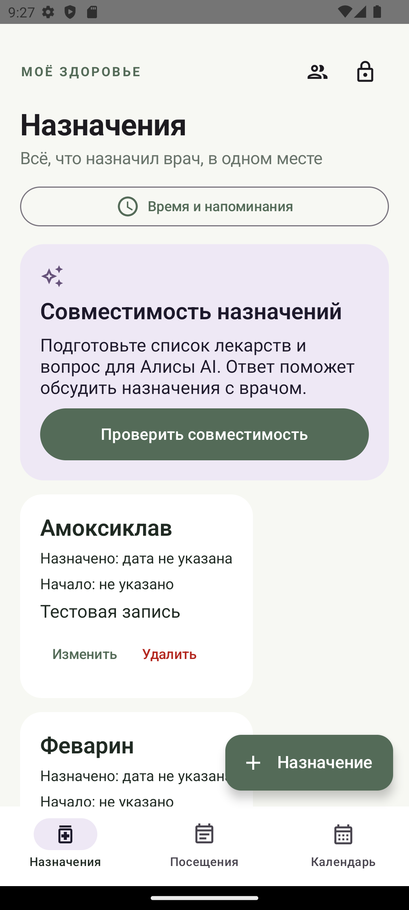</td>
    <td>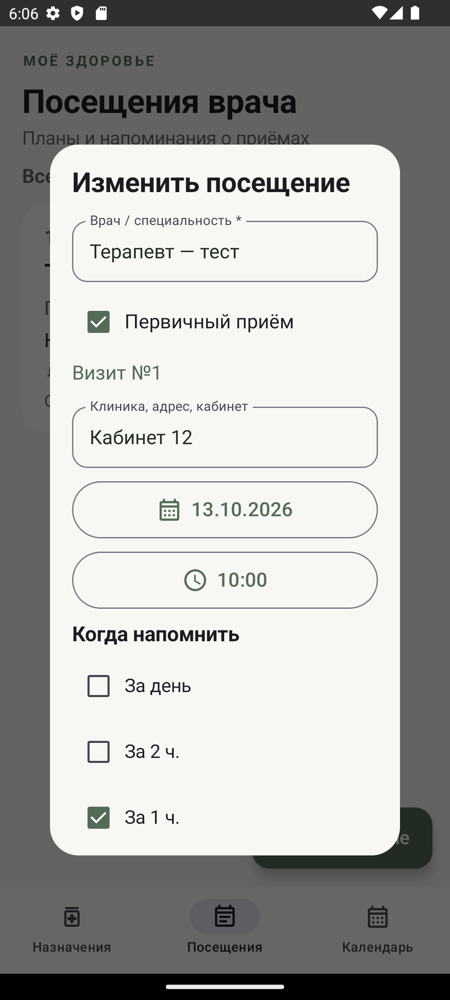</td>
    <td>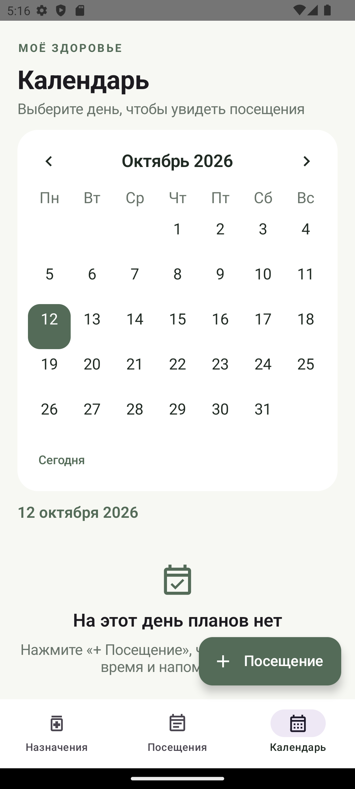</td>
  </tr>
</table>

<table>
  <tr>
    <th>Распознавание документа</th>
    <th>Запрос для Алисы</th>
  </tr>
  <tr>
    <td>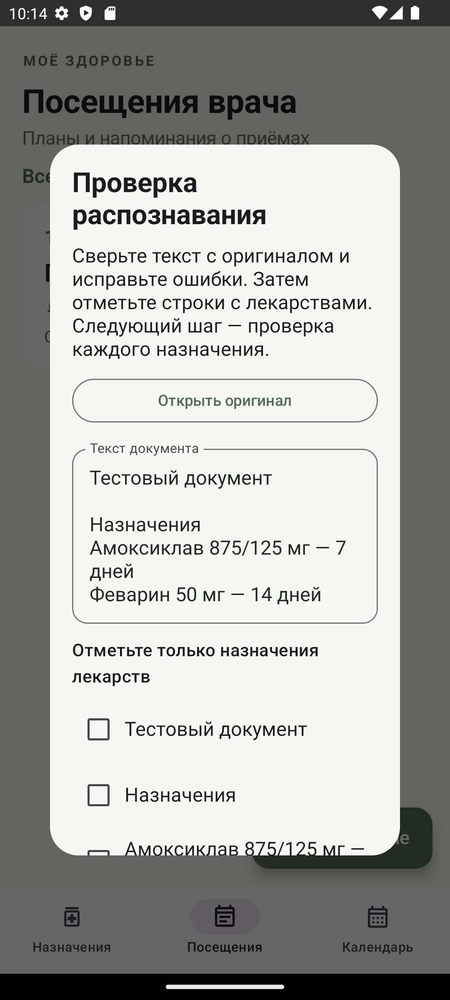</td>
    <td>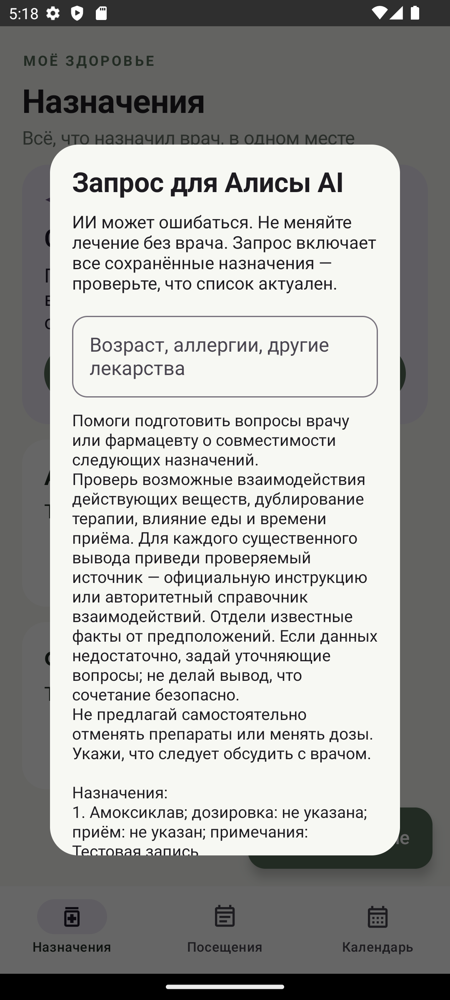</td>
  </tr>
</table>

### Утро без фиксированного времени подъёма

<table>
  <tr><th>Начало дня</th><th>Ожидание перед завтраком</th></tr>
  <tr>
    <td>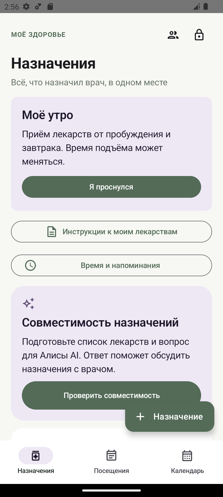</td>
    <td>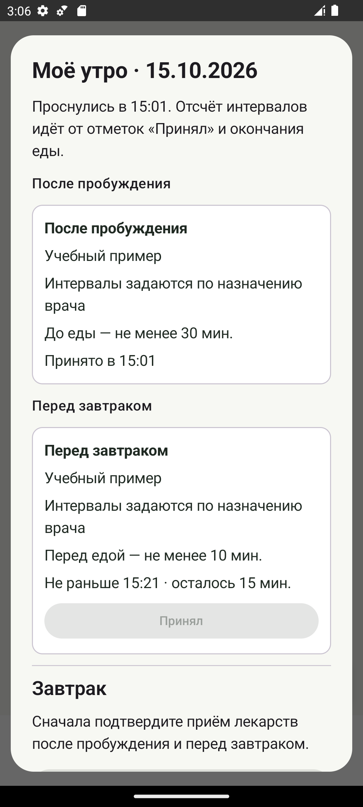</td>
  </tr>
  <tr><th>Во время еды</th><th>После завтрака</th></tr>
  <tr>
    <td>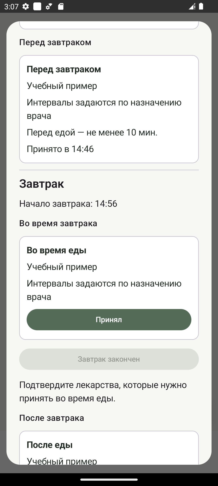</td>
    <td>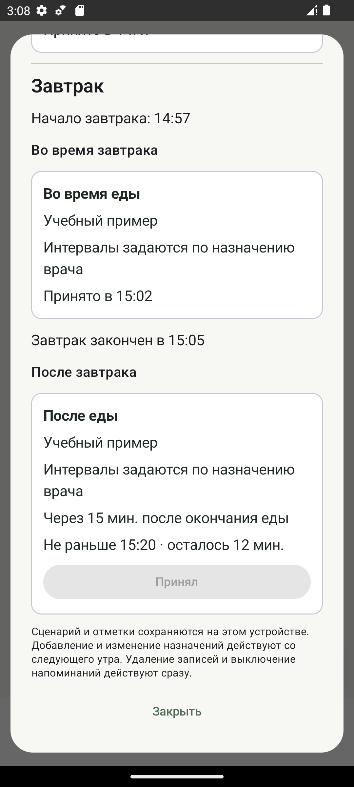</td>
  </tr>
</table>

### Чтение инструкций

<table>
  <tr><th>Поиск по всему документу</th><th>Разделы инструкции</th><th>Распознавание скана</th></tr>
  <tr>
    <td>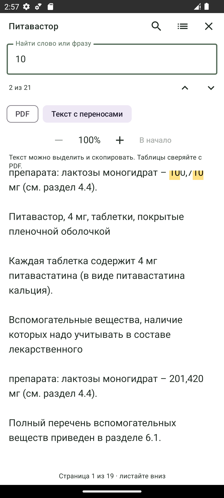</td>
    <td>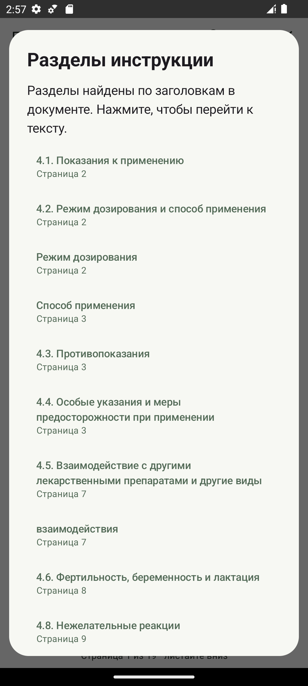</td>
    <td>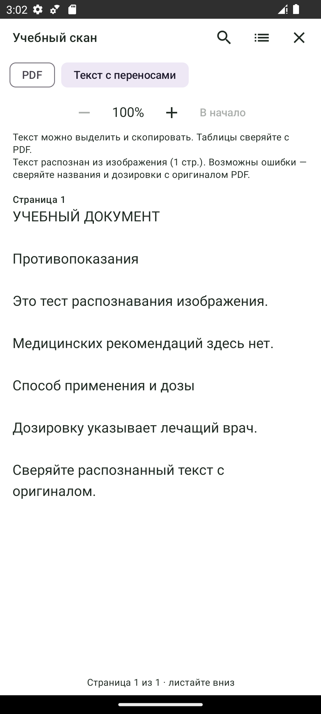</td>
  </tr>
</table>

## Возможности

### Назначения и напоминания

- Название препарата, МНН (действующее вещество), дозировка, указания врача и необязательное фото упаковки.
- Дата назначения и дата начала применения; галочка для совпадающих дат. Длительность курса задаётся количеством календарных дней, последний день вычисляется включительно. Можно оставить курс без установленного окончания.
- Способ применения, в том числе наружная обработка раны. Для применения внутрь можно указать отношение к еде.
- Расписание: ежедневно, через день, каждые N дней или в выбранные дни недели. Указания врача хранятся отдельно: произвольный текст не преобразуется в расписание автоматически.
- Утро, день, вечер и ночь с настраиваемым временем. Напоминания можно выключить для отдельного назначения или всех лекарств.
- В календаре посещения отмечены зелёным, применения лекарств — фиолетовым. Лекарства можно скрыть из календаря отдельно от отключения уведомлений.

МНН можно указать для любого препарата и изменить вручную. Автозаполнение пока работает только для части названий из небольшого встроенного справочника; общей базы лекарств в приложении пока нет. Если название не найдено или одному названию соответствуют разные действующие вещества, поле автоматически не заполняется. Введённое пользователем значение не перезаписывается.

Текущий справочник составлен по каталогам Teva и Промомед от 14.10.2026 и инструкции Форсиги. Это ограничение охвата текущей версии, а не перечень всех возможных источников МНН. В [ГРЛС](https://grls.rosminzdrav.ru/GRLS.aspx) можно найти МНН и для препаратов других производителей; автоматическое получение данных из общего реестра пока не реализовано.

### Моё утро

В назначении можно выбрать «Отсчёт времени → От пробуждения и завтрака», этап утра и интервал в минутах из назначения врача. Поддерживаются приёмы после пробуждения, перед завтраком, во время и после еды. Для нескольких приёмов одного препарата нужны отдельные записи.

Кнопка «Я проснулся» запускает сценарий на текущий день. Приём каждого лекарства подтверждается кнопкой «Принял». Интервал до еды отсчитывается от фактического подтверждения; опоздание с таблеткой перед завтраком сдвигает время завтрака. После отметки начала еды доступны назначения во время завтрака, после отметки окончания — отсчёт для назначений после еды. Приложение учитывает дни курса и схемы через день / по дням недели.

Напоминания можно отключить для одного назначения или всех лекарств. В календаре утренние назначения показаны отдельно, без выдуманного фиксированного времени. Начатый сценарий переживает закрытие приложения и перезагрузку. Добавление и изменение назначений применяются со следующего утра; удаление и выключение напоминаний — сразу. Отметки приёма и ход утра пока хранятся только на этом устройстве и не синхронизируются с семьёй.

### Посещения врача

- Врач, клиника, адрес, кабинет, дата, время и заметки.
- Отметка первичного приёма и номер посещения.
- Напоминания за день, два часа, час или произвольное количество минут. По умолчанию — за день и два часа.
- Передача события в календарь телефона через экран подтверждения. Изменения в стороннем календаре обратно в приложение не поступают.
- Просмотр посещений по дням в календаре и быстрый переход к сегодняшнему дню.

У посещений и лекарств разные каналы уведомлений. После изменения или удаления записи старые напоминания отменяются; будущие восстанавливаются после перезагрузки, обновления приложения и изменения времени или часового пояса.

### Документы и распознавание назначений

К посещению можно прикрепить фото или PDF, либо сфотографировать документ камерой телефона. Приложение сохраняет собственную копию: удаление исходного файла не удаляет вложение. При удалении посещения удаляются и его документы.

Русский и английский печатный текст распознаётся **на телефоне** с помощью Tesseract4Android. Модели включены в APK; интернет, регистрация, подписка и ключ API не нужны. Один файл — до 25 МБ, распознавание PDF — до 10 страниц.

Распознанный текст можно исправить, выбрать строки с лекарствами и проверить каждое назначение перед сохранением. Переносятся явно найденные дозировка и число дней; начало применения и время пользователь задаёт сам. Напоминания автоматически не включаются. Рукопись и плохие фотографии могут распознаваться с ошибками — результат нужно сверять с оригиналом.

Для сложного документа можно подготовить запрос для Алисы, скопировать его и открыть сервис. Ответ не импортируется автоматически; доступность и лимиты зависят от внешнего сервиса.

### Совместимость назначений

Кнопка «Проверить совместимость» собирает список назначений, включая МНН и способ применения, в вопрос для Алисы AI. Запрос доступен для просмотра перед копированием; вводную часть можно отредактировать и сохранить на этом телефоне или восстановить исходный текст.

Кнопка «Скопировать и открыть Алису» открывает сайт — текст нужно вставить самостоятельно. Приложение не отправляет запрос автоматически и не делает собственного медицинского заключения. Ответ ИИ нужно обсуждать с врачом или фармацевтом; он не служит основанием самостоятельно менять лечение.

### Инструкции к моим лекарствам

- Сохранение PDF в закрытом хранилище и чтение без интернета.
- Непрерывная прокрутка вниз, сохранение страницы чтения и кнопка возврата в начало. Режим оригинального PDF и текстовый режим с переносом строк по ширине. Шаг увеличения — 10%; расположение таблиц следует сверять с оригиналом.
- Поиск по всем страницам от двух символов, подсветка совпадений и переход вперёд / назад. Разделы «Противопоказания», «Способ применения и дозы» и другие формируются из найденных заголовков документа; переход открывает соответствующий текст.
- Для страниц без текстового слоя — кнопка «Распознать для поиска». Печатный русский и английский текст обрабатывается на телефоне без интернета. Видны ход обработки и кнопка остановки; сохранённые страницы не требуется распознавать повторно. Результат доступен для поиска и разделов, оригинальный PDF остаётся доступен для сверки.
- Распознанные страницы сопровождает постоянная пометка: **«Текст распознан из изображения. Возможны ошибки — сверяйте названия и дозировки с оригиналом PDF»**. Это особенно важно для дозировок, единиц измерения и названий лекарств.
- Поиск в ГРЛС с подставленным названием и ссылки на официальные источники: Renewal, Биннофарм Групп, Озон Фармацевтика, Teva, Dr. Reddy’s и Промомед.
- Прямые ссылки для Форсиги (PDF AstraZeneca) и Питавастора (ОХЛП Teva для таблеток 1 / 2 / 4 мг). Для других препаратов документ выбирается на сайте или прикрепляется с телефона; универсального автоматического поиска нет. Код с картинки в ГРЛС вводится вручную.
- Подсказки для терминов МНН, ОХЛП, ЛВ, РУ и ГРЛС доступны без интернета.

Перед загрузкой нужно сверить название, форму, дозировку, производителя и редакцию документа с упаковкой и ГРЛС. ОХЛП — документ для специалистов. Скачивание допускается по HTTPS с поддерживаемых официальных доменов; PDF проверяется перед заменой сохранённой версии, размер — до 25 МБ. Инструкции не обновляются автоматически и пока не передаются семейной синхронизацией.

## Установка и обновление

1. На телефоне с Android 13 или новее скачать [care-notes-0.6.0.apk](https://github.com/mykolaq/care-notes/releases/download/v0.6.0/care-notes-0.6.0.apk).
2. Открыть APK и разрешить установку из используемого браузера или файлового менеджера, если Android попросит.
3. Установить приложение и разрешить уведомления. Для точного времени включить «Будильники и напоминания» в системных настройках.

Опубликованный APK — текущая тестовая сборка `debug`, подписанная тем же ключом, что и ранее переданные APK. Установка поверх прежней версии сохраняет записи; удалять приложение перед обновлением не нужно. В релизе также находится файл SHA-256 для проверки скачивания.

При самостоятельной сборке на другом компьютере будет использован другой ключ `debug`; такой APK не сможет обновить уже установленную сборку с прежней подписью. Ключи подписи не публикуются в репозитории.

Без разрешения на точные напоминания Android может задерживать уведомления. После принудительной остановки приложения фоновая работа блокируется до следующего запуска. На настоящем телефоне следует проверить доставку уведомлений при закрытом приложении и настройки энергосбережения.

## Семейная синхронизация и защита входа

Необязательный сервер на собственной VPS позволяет нескольким членам семьи видеть и редактировать назначения, посещения, документы и фото упаковок. Владелец выдаёт одноразовые приглашения с правом просмотра или редактирования и может отключать устройства. Сервер рассчитан на одну семью — до 10 устройств.

Архив шифруется на телефоне **AES-256-GCM**; ключ семьи не передаётся серверу. Изменения разных записей объединяются, а конфликт одной записи требует выбора версии. Напоминания настраиваются отдельно на каждом телефоне: для новых записей, полученных с другого устройства, они выключены. Для обмена фото все устройства нужно обновить до 0.5.1.

Сервер поддерживает публичный IP и отдельный HTTPS-порт, по умолчанию `8443`. Caddy выпускает сертификат собственного центра сертификации; публичный корневой сертификат выбирается в приложении при подключении. VPN не требуется. Развёртывание, сертификаты, приглашения и резервные копии описаны в **[server/README.md](server/README.md)**.

В приложении можно включить пароль и системную биометрию. Пароль обязателен как запасной способ входа; его проверка использует PBKDF2-HMAC-SHA256 со случайной солью и 600 000 итераций. После пяти неверных попыток действует пауза 30 секунд. При включённом пароле содержимое закрывается после ухода в фон, снимки экрана блокируются, подробности новых уведомлений скрываются.

Пароль защищает вход в интерфейс; локальные записи отдельно этим паролем не шифруются. Их защищает закрытое хранилище Android. Серверу известны IP соединений, названия устройств, роли и размер архива. Отзыв доступа не удаляет уже скачанные записи; подробные ограничения описаны в документации сервера.

## Где хранятся данные

По умолчанию записи и вложения находятся только на телефоне. Интернет используется для включённой семейной синхронизации, поиска и скачивания инструкций, а также при самостоятельном открытии Алисы.

При поиске инструкции выбранному сайту передаётся название препарата. При ручной отправке запроса в Алису внешний сервис получает текст, который пользователь вставил: список назначений или выбранный текст документа. Названия врачей в запрос о совместимости не включаются; текст прикреплённого документа может содержать личные сведения.

Резервное копирование Android отключено. **Удаление приложения удаляет локальные данные.** Для восстановления семейных данных нужны серверная копия и заранее сохранённый секретный код восстановления. Автоматическая загрузка из личного кабинета НМИЦ онкологии им. Н. Н. Блохина пока не реализована.

## Сборка из исходников

Нужны Android Studio, JDK 21, Android SDK Platform 36 и Build Tools 36.0.0. В проекте используются Gradle Wrapper 8.11.1, Android Gradle Plugin 8.9.2 и Kotlin 2.1.20. Дополнительная установка Kotlin не нужна.

1. Клонировать репозиторий и открыть его папку в Android Studio через **Open**.
2. Выбрать JDK 21 в **Settings → Build, Execution, Deployment → Build Tools → Gradle → Gradle JDK**.
3. Установить SDK через SDK Manager и дождаться Gradle Sync. При первой сборке нужен интернет для зависимостей.
4. Запустить конфигурацию `app` на эмуляторе или телефоне с Android 13 и новее.

Сборка и проверки в Windows PowerShell, если `JAVA_HOME` уже указывает на JDK 21:

```powershell
.\gradlew.bat assembleDebug testDebugUnitTest lintDebug
```

В Linux или macOS:

```sh
./gradlew assembleDebug testDebugUnitTest lintDebug
```

Готовый APK: `app/build/outputs/apk/debug/app-debug.apk`.

Проверки сервера не требуют VPS или сторонних Python-пакетов:

```sh
cd server
python -m unittest discover -s . -p 'test_*.py' -v
```

## Структура проекта

```text
app/
  src/main/java/com/carenotes/app/  # Интерфейс, данные, напоминания, OCR и синхронизация
  src/main/assets/tessdata/        # Русская и английская модели распознавания
  src/main/assets/licenses/        # Лицензии движка и моделей OCR
  src/test/                       # Модульные тесты Android-приложения
docs/screenshots/                 # Скриншоты с тестовыми данными
docs/badges/                      # Локальные SVG-значки для README
gradle/wrapper/                   # Gradle Wrapper
server/                           # HTTPS-сервис синхронизации, Docker Compose и тесты
```

Тесты покрывают интервалы утреннего сценария и позднее подтверждение приёма, поиск и выделение заголовков инструкции, расписания и напоминания, разбор документов, состав запроса для Алисы, слияние записей, конфликты, шифрование и пароли. Серверные тесты проверяют приглашения, права доступа, отзыв устройств и авторизацию HTTP.

В репозитории нет пользовательских медицинских данных, ключей подписи, локальных настроек SDK и серверных секретов. Лицензии Tesseract4Android и языковых моделей находятся в [app/src/main/assets/licenses](app/src/main/assets/licenses).

## Лицензия

Собственный код проекта опубликован под [BSD Zero Clause License (0BSD)](LICENSE). Его можно использовать, изменять и распространять для любых целей, включая коммерческие и закрытые проекты, без обязательного указания автора. [Стандартный текст 0BSD](https://spdx.org/licenses/0BSD.html).

Сторонние библиотеки и модели распознавания сохраняют свои лицензии. Применение 0BSD к коду проекта не меняет условия их использования; лицензии поставляемых компонентов OCR находятся в [app/src/main/assets/licenses](app/src/main/assets/licenses).
